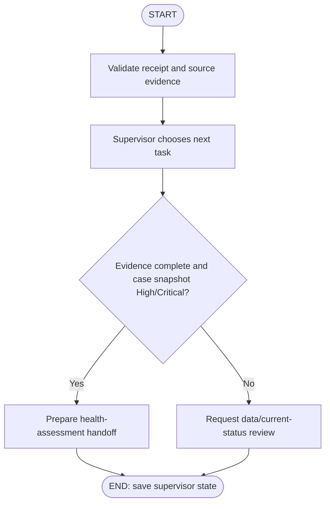

# Phase 3 Step 2: start the LangGraph supervisor

The supervisor coordinates an investigation. It validates the Step 1 receipt, chooses the next task and saves the plan. This implementation is a deterministic workflow supervisor: no LLM/provider/API key is involved yet. Specialist agents are not executed by this step.

## Run on Windows

Stop the worker with Ctrl+C before updating, then run each command from the repository root:

```powershell
cd "C:\Users\yp15r\Downloads\TyreMind-main\TyreMind"
git pull
python -m pip install -e ".[agents]"
python -m tyremind.agents.supervisor
python -m unittest discover -s tests -p test_supervisor.py -v
```

Uses the existing Step 1 consumer ID `local-phase3`, receipt and local database. If there is no receipt, it receives one available pending investigation using Step 1; if none exists, it reports `NO_WORK`. No models are retrained. Default worker behavior remains Phase 2 publishing; this supervisor runs as a standalone command.

## Graph actually executed in this step



A complete input yields `AWAITING_HEALTH_ASSESSMENT`. Partial evidence, recorded data issues, or an event snapshot whose current level has recovered/changed yields `AWAITING_DATA_REVIEW`. This preserves the original High/Critical risk; it does not declare the tyre safe or cancel its alert. Review routing records a pending task only; it does not notify or assign a human automatically.

The task plan records health assessment → root-cause analysis → technical-evidence retrieval → maintenance planning → human review. When needed, DATA_REVIEW comes first. These are planned tasks, not completed results or additional queued investigation jobs. The corresponding specialist implementations belong to subsequent steps.

Example: a High event with low pressure and complete evidence goes to HEALTH_ASSESSMENT. If its assessment is partial because temperature is missing, the supervisor first records DATA_REVIEW with that reason. It does not invent the missing reading or produce a diagnosis.

## Concepts used

| Concept | Meaning in TyreMind |
|---|---|
| StateGraph | LangGraph's graph builder connects functions and shares investigation data between them. |
| State | A typed dictionary holds the original receipt, review reasons, task plan, route, stage and execution trace. |
| Nodes | Python functions validate the event, supervise it and prepare the selected handoff. |
| Edges | Fixed edges sequence the steps; a conditional edge selects the health or review route. |
| START / END | Explicit entry/exit boundaries keep this small graph bounded. END ends routing, not the entire investigation. |
| Pydantic | Validates the input contract and saved supervisor-state schema. |
| Durable checkpoint | SQLite saves the completed supervisor state so a repeated command resumes it. |
| Idempotency | One saved supervisor state per investigation; rerunning does not reroute or create another job. |
| Ownership | Only the receipt's consumer with the current claim token can start this job's supervisor. |

LangGraph itself does not supply reasoning intelligence here. Routing uses explicit Python rules. Adding an LLM later would require provider configuration and constrained tools; it is not silently enabled by installing LangGraph.

## Saved state and restart behavior

SQLite table `phase3_supervisor_states` stores the state, input checksum, supervisor version and output checksum. `phase3_receipts` continues to hold the immutable initial receipt. The investigation remains RUNNING, and result fields remain empty because specialist analysis has not run.

Exports:

```text
data/phase3/supervisor/
├── <investigation_id>.json
└── supervisor_report.json
```

```powershell
Get-Content .\data\phase3\supervisor\supervisor_report.json
explorer .\data\phase3\supervisor
```

The first run reports `STARTED`; another run reports `RESUMED` and does not invoke the graph again. This checkpoint is at the application boundary after the supervisor graph, not a LangGraph node-by-node checkpointer. If execution fails before that database commit, the next command safely reruns the pure routing nodes. If JSON export fails after commit, rerunning exports the saved state. There are no external side effects in these nodes.

Claims/checkpoints use a SQLite transaction; stale ownership, invalid source identities or corrupt checkpoints raise an error instead of marking the investigation complete. No timed claim lease is added here. Use the same consumer ID after restart. New monitoring evidence remains associated with case revisions and the existing follow-up mechanism; it never silently mutates the investigation's original snapshot. A changed supervisor version/input requires explicit migration rather than silently overwriting a saved plan.

## Validation

Ten supervisor tests cover both graph branches, changed case status, receipt/source identity, no fabricated specialist results, idempotent resume without rerunning the graph, graph-error recovery, export-error recovery, checksum protection, consumer ownership and snapshot stability during later escalation. Tests use temporary databases and do not alter your fleet.
